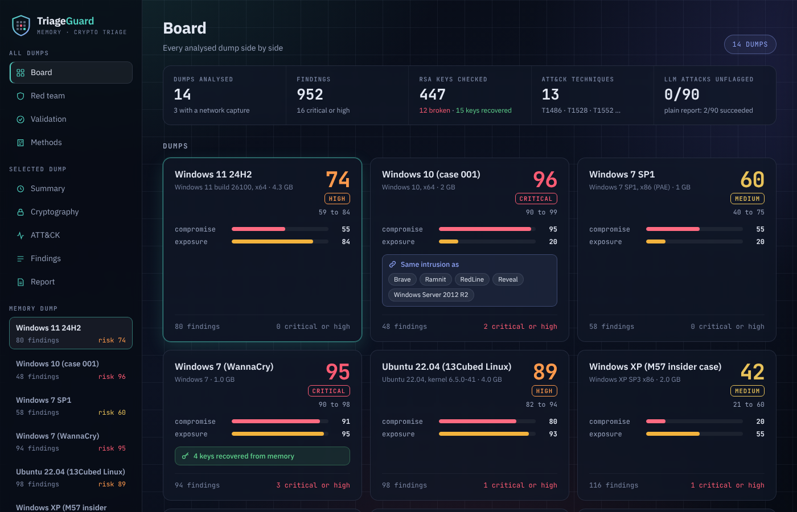

# TriageGuard: Memory Forensics & Crypto Malware Triage

[](https://github.com/HalcyonVector/Triageguard/actions/workflows/pages.yml)

Takes a Windows or Linux memory image (plus an optional packet capture), finds injected code, suspicious processes, ciphers, weak or recoverable keys and leaked credentials, scores the risk with sourced formulas, and writes an incident report where every claim cites the finding behind it. The LLM never sees the raw dump, and a validator checks its report against the rule-based results before anyone reads it. Runs locally on free, public tooling: Volatility 3, Python and an optional free Groq key.

> **Live demo:** [halcyonvector.github.io/Triageguard](https://halcyonvector.github.io/Triageguard/): read-only dashboard over all 14 analysed memory images, served from GitHub Pages.



---

## Findings

Real numbers from running this on public and self-built memory images, not projections:

- **Keys come back out of memory.** Four RSA-2048 private keys are rebuilt from a WannaCry image, and on a self-built Ubuntu VM with planted keys every AES-GCM, ChaCha20 and RSA key is recovered (**12/12 ground-truth checks**).
- **Cipher identification is exact on ground truth:** the cipher a test process actually uses is found 45/45 times across AES-128, AES-256, ChaCha20, RSA and X25519 benchmark cases.
- **The LLM cannot be talked into lying.** 15 prompt-injection attacks (including adaptive ones) hidden in JWT and OTP fields: **2/90 succeed undefended, 0/90 defended**, and 0/90 reach a reader without a warning.
- **Every report is checkable.** All 14 LLM reports pass validation: 90 to 100% of claims cite a finding, and every stated risk matches the rule-based score.
- **False positives are hunted, not tolerated.** A clean Ubuntu baseline scores **28** against 67 to 97 for compromised images, after XP heap segments, libffi trampolines, JIT hosts and Windows' built-in RSA-512 keys were each proven benign and downgraded.

---

## Disclaimer

Educational/portfolio project, not a production forensics tool. Evaluation uses public datasets and synthetic keys and tokens only. Nothing executes malware, and recovered credentials are stored redacted. Only analyse memory images you are authorised to examine.

---

## Features

### Memory Analysis

- Volatility 3 on Windows (XP to 11, Server) and Linux (Ubuntu, CentOS), with the OS detected automatically
- Processes, command lines, network connections, USB history and `malfind` injected regions
- Injected regions classified by content: PE/ELF headers are critical; heap segments, call thunks, libffi trampolines and JIT hosts are benign
- Reverse-shell detection on Linux (shells spawned by `nc`/`socat`, `pty.spawn` upgrades)

### Cryptography

- Cipher identification with a confidence score: AES, DES/3DES, RSA, ChaCha20/Salsa20, AES-GCM, ECC, Curve25519
- RSA weak-key tests: NIST SP 800-57 strength, small exponents, shared moduli, batch-GCD shared primes, Fermat close primes
- Key recovery: RSA private keys from leftover primes, AES key schedules, ChaCha20 keys
- High-entropy region detection for packed or encrypted payloads

### Credentials & Network

- JWT, OAuth/API token and `otpauth://` secret detection, always redacted
- pcap analysis: conversations, DNS, TLS SNI, versions and cipher suites

### Scoring & Correlation

- Compromise and crypto-exposure scores fused with Dempster-Shafer, with CVSS-edge score ranges
- MITRE ATT&CK mapping of findings
- Campaign linking: dumps from the same intrusion joined by rare shared evidence

### Defended LLM Report

- Findings sanitised before the LLM sees them; injected instructions become their own findings
- Mandatory citations on every fact, table row and recommendation
- Rule-based cross-check of scores, algorithms and numbers; a failing report ships with visible validation notes

### Dashboard

- Board, Red team, Validation and Methods views across all dumps; Summary, Cryptography, ATT&CK, Findings and Report per dump
- **Analyse a dump** button: paste an image path, watch the live log, the result lands on the board
- Standard library only, binds to localhost, works offline; a static read-only build powers the live demo

---

## Tech Stack

| Layer | Technology | Details |
|-------|-----------|---------|
| Memory | Volatility 3 | Windows symbols fetched automatically, Linux via ISF tables |
| Static analysis | pefile, YARA | PE headers, section entropy, crypto imports |
| Crypto | cryptography | RSA math, key verification |
| Network | pyshark + tshark | Optional, only for pcaps |
| Storage | SQLite (`sqlite3`) | One row per finding, with a citation id |
| LLM | Groq (gpt-oss-120b) | Optional; any OpenAI-compatible endpoint works |
| Dashboard | Vanilla HTML/CSS/JS | No framework, no build step |
| Hosting | GitHub Pages | Static build deployed by GitHub Actions |
| Testing | pytest | 68 tests |

---

## Prerequisites

- Python 3.10+
- Optional: a free [Groq](https://console.groq.com) key for LLM reports, Wireshark for pcaps

---

## Quick Start

### Windows (one click)

```bash
git clone https://github.com/HalcyonVector/Triageguard.git
```

Double-click **`TriageGuard.bat`** in the cloned folder. The first run creates `.venv`, installs the requirements and opens the dashboard. Results for all 14 images are included, so nothing else needs downloading.

### Any platform

```bash
git clone https://github.com/HalcyonVector/Triageguard.git
cd Triageguard
python -m venv .venv && source .venv/bin/activate   # Windows: .venv\Scripts\activate
pip install -r requirements.txt
python -m triageguard dashboard
```

For LLM reports, put `GROQ_API_KEY=...` in a `.env` file in the project folder. Without it, the rule-based report is produced instead.

---

## Usage

```bash
python -m triageguard analyze memory.raw --pcap traffic.pcap   # full pipeline
python -m triageguard crypto suspicious.bin                     # crypto analysis on any file
python -m triageguard report run.db --out report_llm.md         # write the defended LLM report
python -m triageguard check run.db                              # sanity-check an analysed dump
python -m triageguard redteam --trials 3                        # attack the LLM report, baseline vs defended
python -m triageguard benchmark                                 # ground-truth cipher and key test (Linux)
python -m triageguard dashboard --static site                   # build the read-only dashboard
```

On Windows, `add_dump.ps1` wraps download, unpacking, analysis, export and the LLM report for large public images, and resumes safely if interrupted.

---

## How It Works

1. **Memory:** Volatility 3 plugins extract processes, command lines, connections and injected regions; each region is classified by what it contains.
2. **Static:** dumped regions and binaries get strings, PE parsing, entropy and YARA.
3. **Crypto:** signature tables identify ciphers; keys are extracted, tested and, where possible, recovered.
4. **Credentials & Network:** tokens and secrets are decoded and redacted; pcaps are summarised.
5. **Fusion:** findings map to ATT&CK and fuse into compromise, exposure and overall risk.
6. **Report:** the defended LLM writes a cited report, the validator checks it, or the rule-based report is used.

Every score names its formula and source in [docs/FORMULAS.md](docs/FORMULAS.md). For a plain-language walkthrough, see [docs/HOW_IT_WORKS.md](docs/HOW_IT_WORKS.md).

---

## Project Structure

```
Triageguard/
├── triageguard/          Pipeline: memory, static, crypto/, credentials, network, report, defences
│   └── crypto/           Cipher signatures, RSA weak-key tests, AES/ChaCha20 key finders, key recovery
├── dashboard/            Single-page dashboard (served locally or built for GitHub Pages)
├── results/              Exported results for every image, red-team rounds, benchmark
├── tools/                Lab key planting and scoring, Volatility 2 to ISF converter
├── rules/                YARA rules
├── docs/                 HOW_IT_WORKS.md, FORMULAS.md, screenshot
├── tests/                pytest suite
├── add_dump.ps1          Download, analyse and export a public image (Windows)
└── TriageGuard.bat       One-click setup and dashboard (Windows)
```

---

## Evaluation Data

| Image | OS | Risk |
|-------|----|------|
| 13Cubed Windows challenge | Windows 11 24H2 | 74 |
| DFIR Madness case 001 (desktop, domain controller) | Windows 10, Server 2012 R2 | 96, 96 |
| Hacktoria Memory Mystery | Windows 7 SP1 | 60 |
| WannaCry sample | Windows 7 | 95 |
| M57-Patents | Windows XP SP3 | 42 |
| CyberDefenders Reveal, Brave, RedLine, Ramnit | Windows 10 | 86, 89, 97, 82 |
| 13Cubed Linux challenge | Ubuntu 22.04 | 89 |
| CyberDefenders Seized | CentOS 7.7 | 82 |
| Lab VM with planted keys | Ubuntu 24.04 | 67 |
| Lab VM, clean baseline | Ubuntu 24.04 | 28 |

---

## Testing

```bash
pytest -q
```

68 tests cover cipher identification, RSA weak-key tests, key recovery, injected-region classification, citation checking, the red-team attack scorer and the dashboard export. Lab ground truth is scored with `tools/score_lab.py`.

---

## Known Limitations

- Linux images need the exact kernel's symbol table; without it Volatility cannot read the image
- RSA prime search is skipped in processes larger than 192 MB to keep runs bounded
- Freed keys are not recovered: live keys come back every time, keys from freed memory did not in the benchmark
- Red-team cells are 6 trials each, so the 0/90 defended result is indicative, not proof of zero risk
- A citation proves the cited finding exists, not that the sentence about it is right
- Free-tier Groq limits (about 200k tokens a day) cap how many LLM reports run per day

---

## Project Stats

| Metric | Count |
|--------|-------|
| Memory images analysed | 14 |
| Findings across all images | 952 |
| RSA keys checked | 447 |
| Ciphers identified | 7 families |
| Red-team attacks | 15 |
| Automated tests | 68 |

---

## Author

**Sagnik**

GitHub: [@HalcyonVector](https://github.com/HalcyonVector)

---

## License

MIT License, see [LICENSE](./LICENSE).
